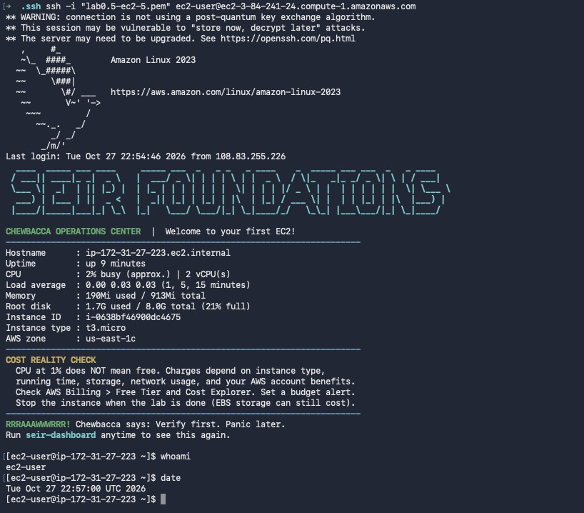
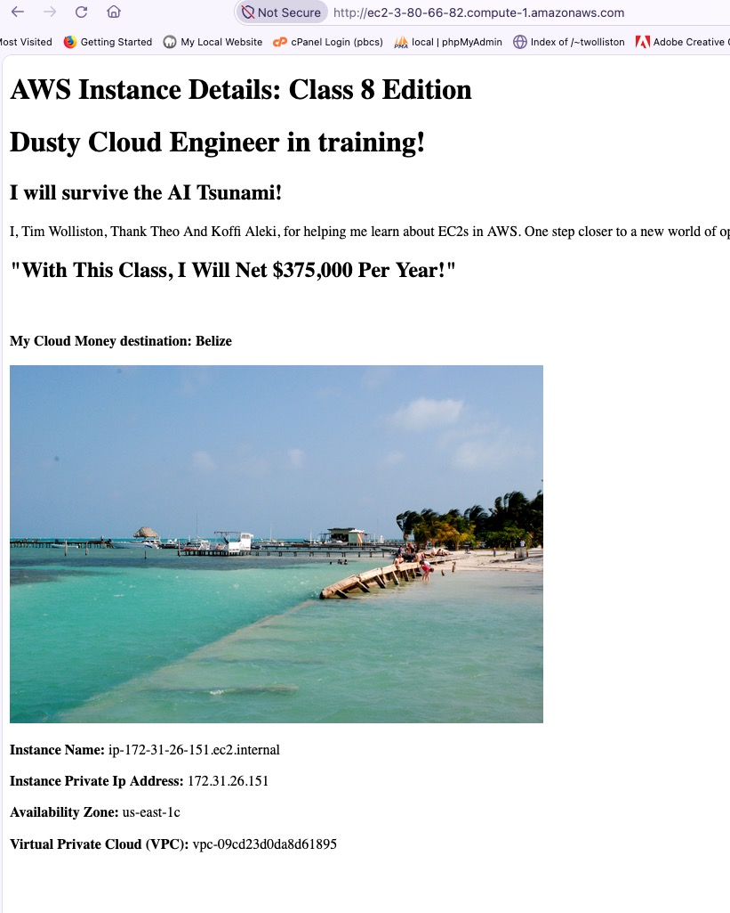
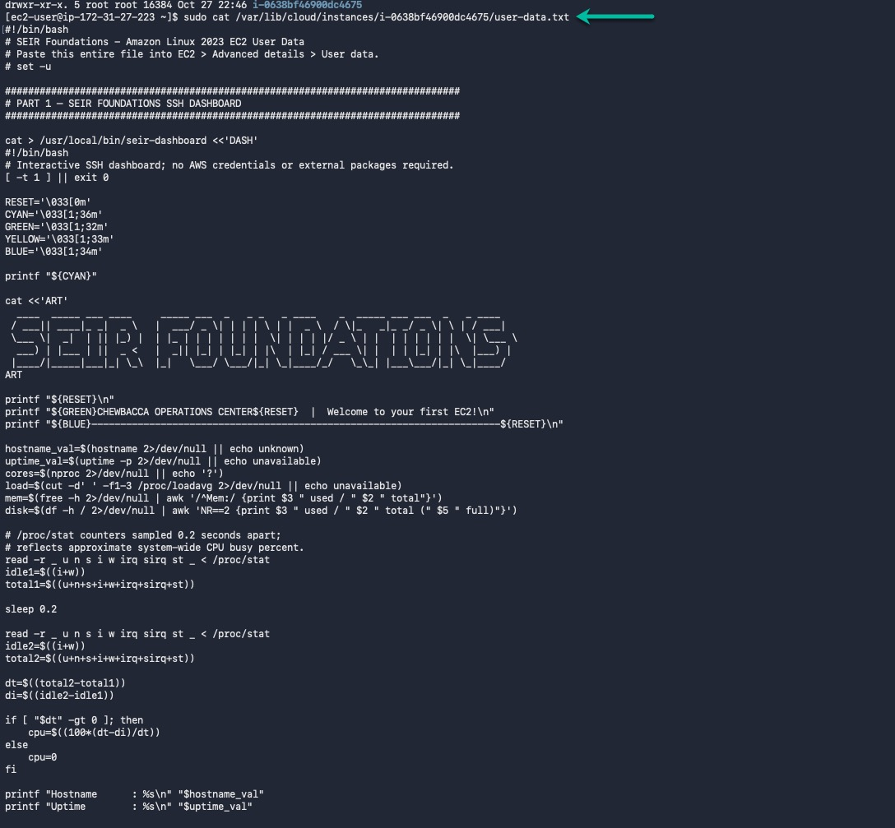
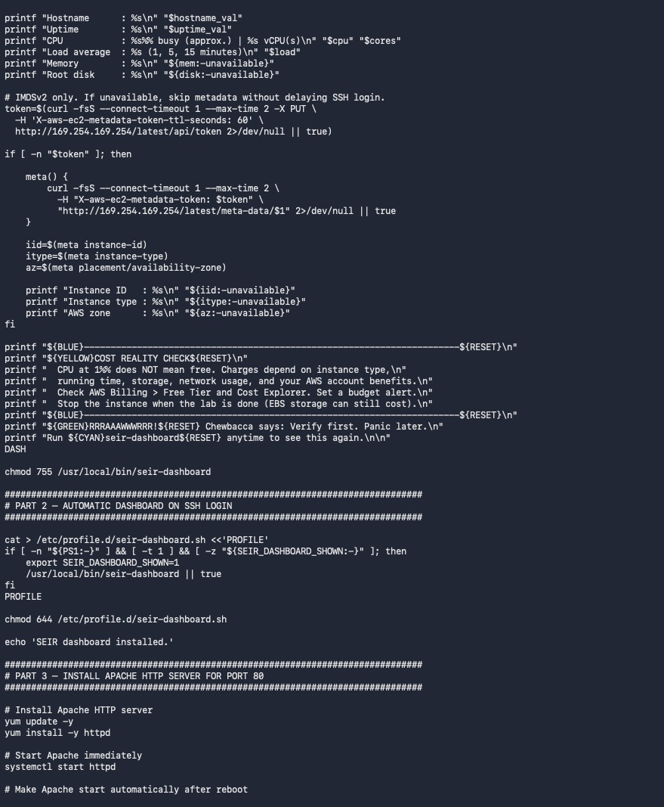
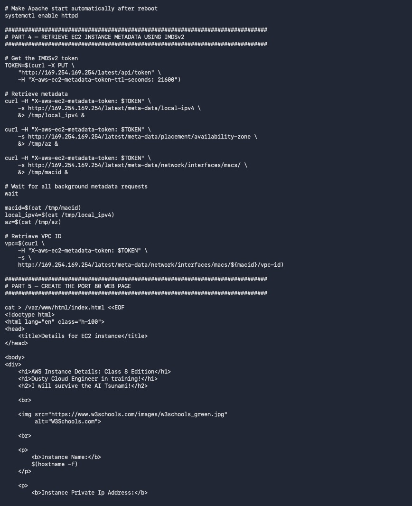
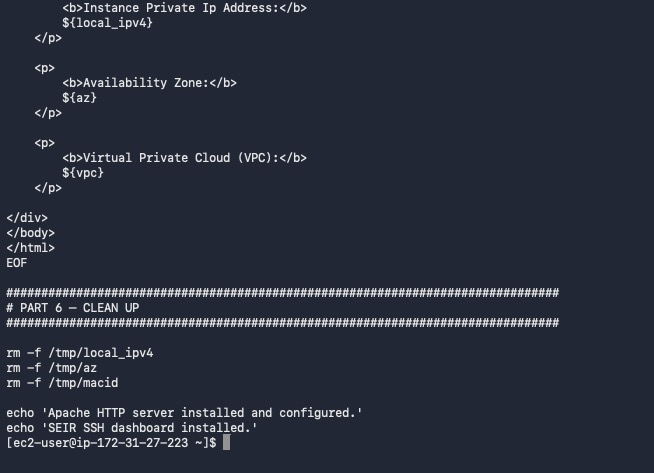

# "Be A Man" (BAM) Extra Credit – EC2 Basics

**Module:** SEIR Foundations – Module 1, Lab 0.5 (Basics Continued)
**Student:** Tim Wolliston
**Spotter:** Koffi Alexi

This extra credit shows three things on one EC2 instance: an SSH connection from my own machine, a customized web page served from the instance, and the `user_data` script that bootstrapped it.

All screenshots are in the [`screenshots/`](./screenshots) folder.

| Item | Description | Submission |
|------|-------------|------------|
| BAM_1.1 | SSH into EC2 from my local machine, running `whoami` and `date` | [`BAM_1.1.jpg`](./screenshots/BAM_1.1.jpg) |
| BAM_1.2 | Customized EC2 web page | [`BAM_1.2.jpg`](./screenshots/BAM_1.2.jpg) |
| BAM_1.3 | `user_data` script displayed over local SSH | [`BAM_1.3.jpg`](./screenshots/BAM_1.3.jpg) |

---

## BAM_1.1 – SSH Connection from My Local Machine

I connected with the SSH client in my own terminal, not EC2 Instance Connect (which does not count for credit).

```bash
# Lock down the key file permissions (required by SSH)
chmod 400 <your-key>.pem

# Connect to the instance
ssh -i <your-key>.pem ec2-user@<EC2-public-IP>

# Required commands
whoami
date
```

**Expected result:** `whoami` returns `ec2-user`, and `date` returns the current date and time on the instance.



---

## BAM_1.2 – Customized EC2 Web Page

The web page served by the instance was changed to show:

> I, **_Your Name_**, Thank Theo And **_Spotter Name_**, for helping me learn about EC2s in AWS. One step closer to a new world of opportunities!
>
> "With This Class, I Will Net **$_Amount_** Per Year!"

It also includes a picture of the destination I'll go to after making Cloud Money and paying my bills: **_Destination_**.

Steps taken over SSH:

```bash
# Edit the page served by the web server
sudo nano /var/www/html/index.html

# Restart the web server if needed
sudo systemctl restart httpd
```

Then I opened `http://<EC2-public-IP>` in a browser to confirm the changes.



---

## BAM_1.3 – Displaying the `user_data` Script over Local SSH

From the same SSH session on my home machine, I found the `user_data` script that ran when the instance launched and displayed it with `cat`.

```bash
# cloud-init keeps a copy of the user data script here
sudo cat /var/lib/cloud/instance/user-data.txt
```






---

## Takeaways

- SSH from a local terminal with a key pair is the standard way to administer an EC2 instance.
- The Apache web root (`/var/www/html`) controls what the public sees at the instance's IP.
- `user_data` scripts run once at first boot, and cloud-init keeps a copy on the instance under `/var/lib/cloud/`.
