# Module 1 · Lesson 1 — Balerica Legacy Bank on EC2

> **Goal:** Complete the Lesson 1 lab (**Steps 0–4**) **SEVEN times** this week, by hand, on **seven brand-new EC2 instances**, to build muscle memory.
>
> **Deadline:** Tuesday, November 3, 2026 @ **12:00 PM CST / 1:00 PM EST / 10:00 AM PST**
>

**SEIR Foundations — FastAPI with a COBOL core**

Source runbook: [module1/lesson1_ec2/API/runbook.md](https://github.com/BalericaAI/SEIR-Foundations/blob/main/module1/lesson1_ec2/API/runbook.md)

In this lesson you clone the course repo onto an EC2 instance, install GnuCOBOL, run COBOL programs against a fixed-width ledger, put a FastAPI web layer in front of them, send SWIFT MT103 test traffic, and try the built-in Balerica AI helper.

---

## How to read this README

Every block of commands is labeled with **where it runs**:

| Label | Meaning |
|-------|---------|
| ☁️ **Run on: Linux EC2 instance** | Type it inside your SSH session on the EC2 server (prompt shows `ec2-user@ip-...`) |
| 💻 **Run on: Local machine — macOS (Terminal)** | Type it on your own Mac |
| 💻 **Run on: Local machine — Windows (PowerShell)** | Type it on your own Windows PC |
| 🌐 **Run on: Local machine — Web browser** | Do it in a browser on your own computer |

Rules of the road:

1. Paste **one command at a time**, read the output, then move on.
2. Your output only needs to look *similar* to the expected output (IPs, timestamps and IDs will differ).
3. Do not type the leading `$` if you see one.
4. If something goes wrong, stop, read the message, and check [Troubleshooting](#troubleshooting).

📸 **Screenshots:** each step ends with a screenshot slot. Save your images in a `screenshots/` folder next to this README using the suggested file name, and they will show up automatically.

---

## Prerequisites — Launch EC2 and connect with SSH

You should already have a running Amazon Linux EC2 instance, its key pair (`your-key.pem`), and its **public IP**.

💻 **Run on: Local machine — macOS (Terminal)**

```bash
chmod 400 your-key.pem
ssh -i your-key.pem ec2-user@YOUR-EC2-IP
```

💻 **Run on: Local machine — Windows (PowerShell)**

```powershell
ssh -i .\your-key.pem ec2-user@YOUR-EC2-IP
```

> Replace `your-key.pem` with the path to your key and `YOUR-EC2-IP` with your instance's public IP.
> This SSH window is **Window 1** for the rest of the lesson.

📸 **Screenshot — SSH login successful**

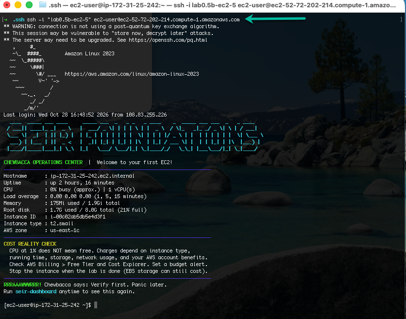

---

## Step 0 — Prove you are on the server

☁️ **Run on: Linux EC2 instance** (Window 1)

```bash
whoami
```

Expected:

```
ec2-user
```

```bash
pwd
```

Expected:

```
/home/ec2-user
```

> `pwd` = print working directory. Use it any time you are not sure which folder you're in.

📸 **Screenshot — `whoami` and `pwd` output**

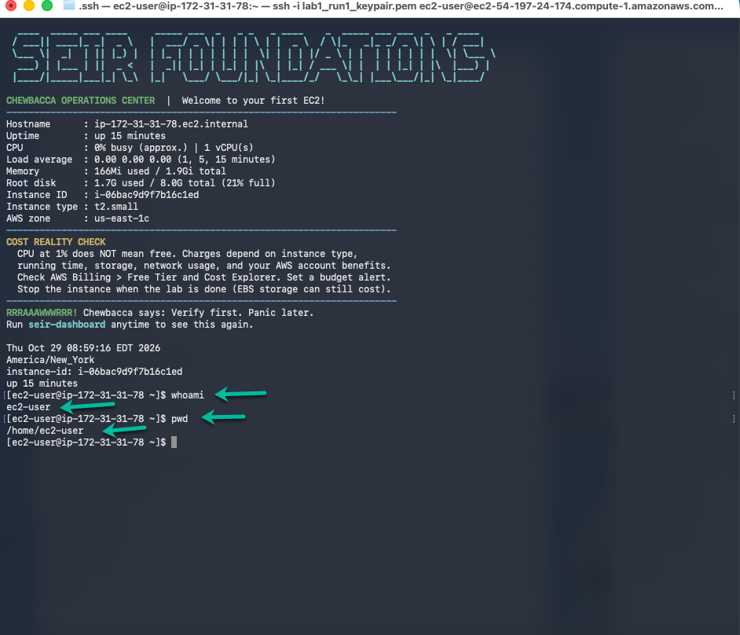

---
## Step 0.1 — Run optional additional commands on the server using menu.sh 

```bash
clear && seir-dashboard && ./menu.sh
```

📸 **Raw Code — `Menu.sh`**


📸 **Screenshot — `Additional Commands Menu` output**
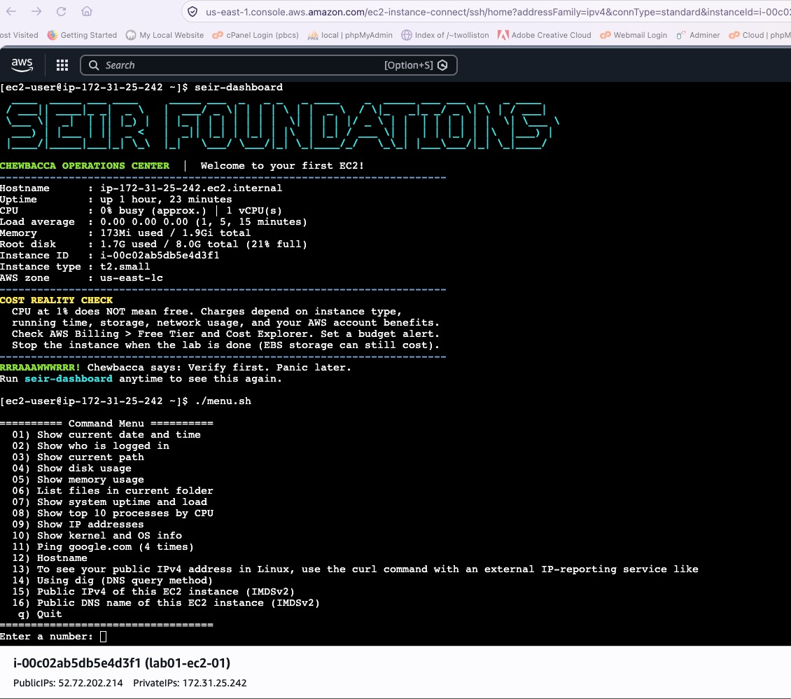

---
## Step 0.2 — Run optional Balerica Legacy Bank Access commands on the server using legacy_bank_app.sh 

```bash
clear && seir-dashboard && ./legacy_bank_app.sh
```

📸 **Raw Code — `legacy_bank_app.sh`**


📸 **Screenshot — `legacy_bank_app.sh app` output**
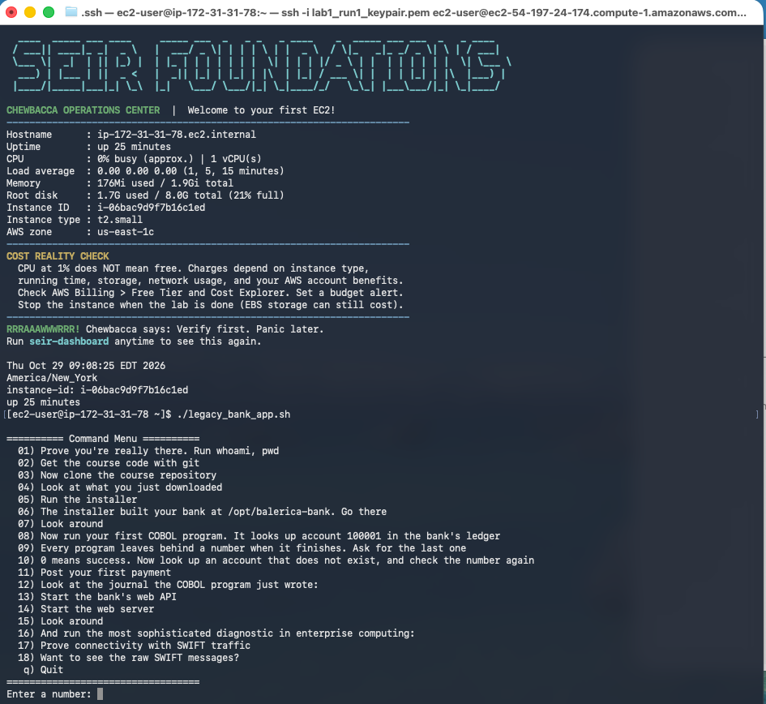

---

## Step 1 — Get the course code with git

☁️ **Run on: Linux EC2 instance** (Window 1)

Set Time Zone:

```bash
sudo timedatectl set-timezone America/New_York
```

Install git:

```bash
sudo dnf install -y git
```

Expected (last line): `Complete!` — or `Nothing to do` if git was already installed. Both are fine.

Clone the course repository:

```bash
git clone https://github.com/BalericaAI/SEIR-Foundations.git
```

Expected:

```
Cloning into 'SEIR-Foundations'...
remote: Enumerating objects: ...
Receiving objects: 100% ...
Resolving deltas: 100% ..., done.
```

List what you downloaded:

```bash
clear && seir-dashboard && whoami && date && timedatectl show -p Timezone --value && ec2-metadata -i && uptime -p && ls SEIR-Foundations
```

Expected:

```
README.md  module1  module2  module3  module4  playbook.md  podcasts.md  python
```

📸 **Screenshot — successful clone and `ls` output**

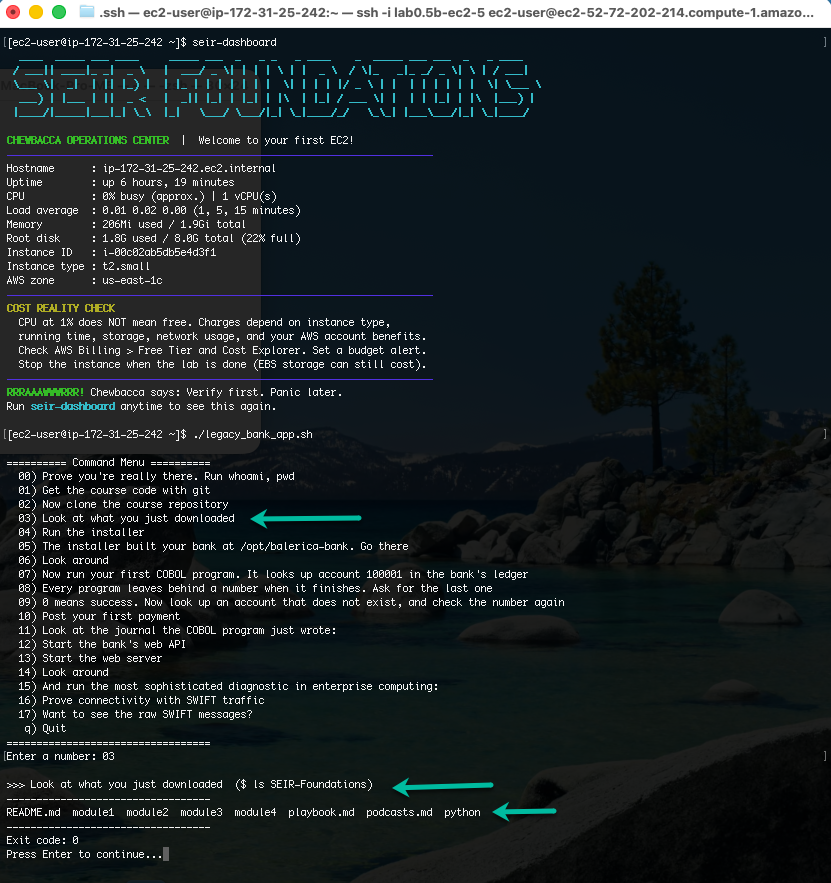

---

## Step 2 — Run the installer

☁️ **Run on: Linux EC2 instance** (Window 1)

The installer sets up GnuCOBOL, creates the bank, seeds the accounts and compiles the COBOL programs. Run it once (it is safe to re-run if it fails).

```bash
bash SEIR-Foundations/module1/lesson1_ec2/API/install/install.sh
```

Expected (takes a few minutes):

```
======================================
 BALERICA LEGACY BANK INSTALLER
======================================

[1/9] Updating packages...
[2/9] Installing dependencies...
[3/9] Creating directories...
[4/9] Copying Balerica Bank sources...
[5/9] Creating Python virtual environment...
[6/9] Installing Python packages...
[7/9] Creating database...
[8/9] Compiling COBOL programs...
[9/9] Exporting the ledger for the COBOL core...
  exported 3 account(s) to data/accounts.dat

Installation complete.
```

> ✅ What matters: `[8/9] Compiling COBOL programs...` with **no errors** after it, and `Installation complete.`
> If it fails, run it again. If it fails twice in the same place, see [Troubleshooting](#troubleshooting).

📸 **Screenshot — "Installation complete."**

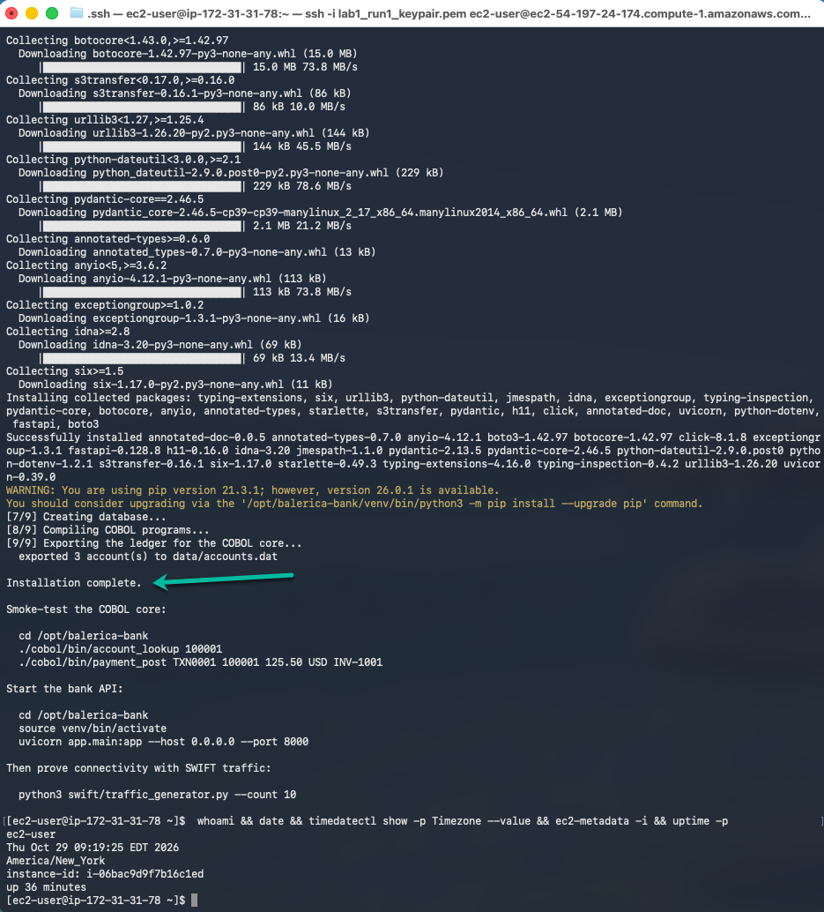

---

## Step 3 — Meet the COBOL core

☁️ **Run on: Linux EC2 instance** (Window 1)

Go to the bank directory and look around:

```bash
cd /opt/balerica-bank
```

```bash
ls
```

Expected:

```
agents  app  cobol  data  logs  swift  venv
```

### 3a. Look up an account

```bash
./cobol/bin/account_lookup 100001
```

Expected:

```
ACCOUNT=100001
NAME=Alice Johnson
STATUS=ACTIVE
BALANCE=5000.00
CURRENCY=USD
```

### 3b. Check return codes

```bash
echo $?
```

Expected: `0` (success)

Now try an account that does not exist:

```bash
./cobol/bin/account_lookup 999999
```

```bash
echo $?
```

Expected:

```
ERROR=ACCOUNT NOT FOUND
ACCOUNT=999999
4
```

Return code reference:

| Code | Meaning |
|------|---------|
| 0 | success — account found / payment POSTED |
| 4 | warning — account not found |
| 8 | business rejection — not ACTIVE, zero amount, insufficient funds |
| 12 | environment failure — missing file, malformed arguments |

### 3c. Post your first payment

```bash
./cobol/bin/payment_post TXN0001 100001 125.50 USD INV-1001
```

Expected:

```
TXN=TXN0001
ACCOUNT=100001
AMOUNT=125.50
CURRENCY=USD
STATUS=POSTED
REASON=APPROVED
```

View the fixed-width payment journal:

```bash
cat data/payments.dat
```

Expected:

```
TXN0001             100001000000012550USDPOSTED  INV-1001
```

> `000000012550` = 125.50. The decimal point is implied by the program — it is never stored in the file. See the [ledger layout](#fixed-width-ledger-dataaccountsdat).

📸 **Screenshot — account lookup (Not found with return codes)**

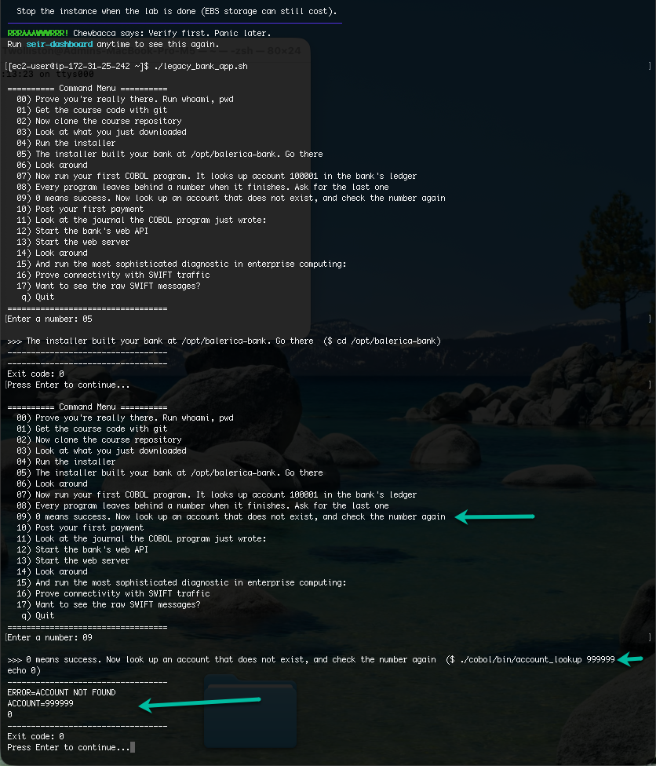

📸 **Screenshot — account lookup (found with return codes)**

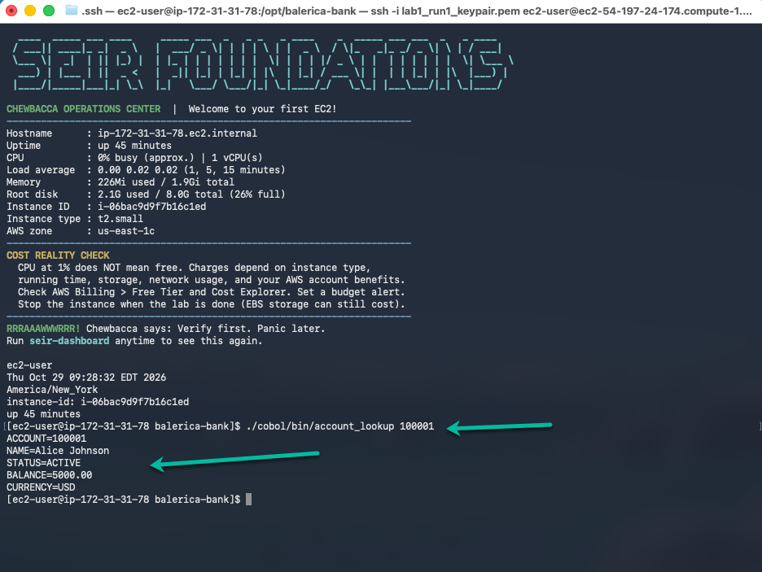

📸 **Screenshot — payment posted and `payments.dat` contents**

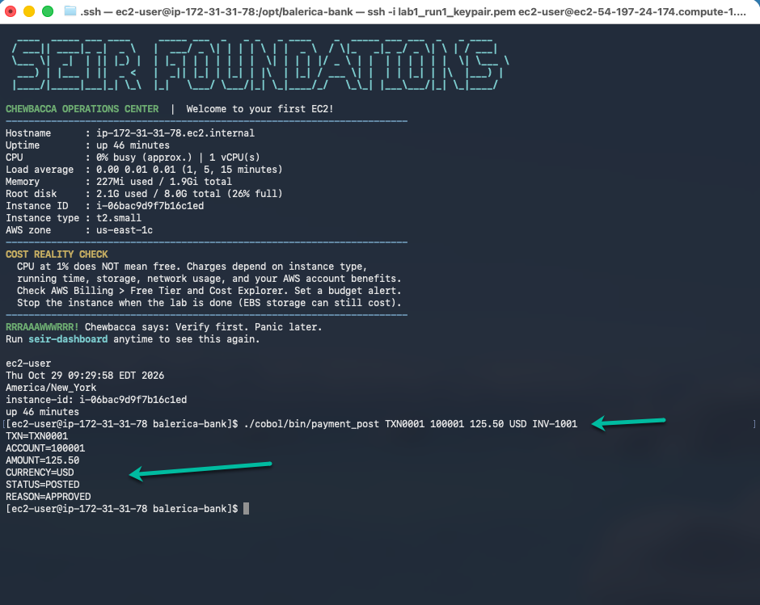

---

## Step 4 — Start the bank's web API

☁️ **Run on: Linux EC2 instance** (Window 1)

** Display ID:
```bash
clear && seir-dashboard && whoami && timedatectl show -p Timezone --value && date && ec2-metadata -i && uptime -p && TZ=UTC who -b
 ```

Activate the Python virtual environment:

```bash
cd /opt/balerica-bank
```

```bash
source venv/bin/activate
```

Your prompt should now start with `(venv)`.

Start the API server:

```bash
uvicorn app.main:app --host 0.0.0.0 --port 8000
```

** -or- **

```bash
BEDROCK_MODEL_ID=us.anthropic.claude-sonnet-4-6 AWS_REGION=us-east-1 uvicorn app.main:app --host 0.0.0.0 --port 8000
```

Expected:

```
INFO:     Started server process [12345]
INFO:     Waiting for application startup.
INFO:     Application startup complete.
INFO:     Uvicorn running on http://0.0.0.0:8000 (Press CTRL+C to quit)
```

> ⚠️ **Window 1 is now busy running the server.** Don't type in it and don't close it.

📸 **Screenshot — Uvicorn running with `(venv)` in the prompt**

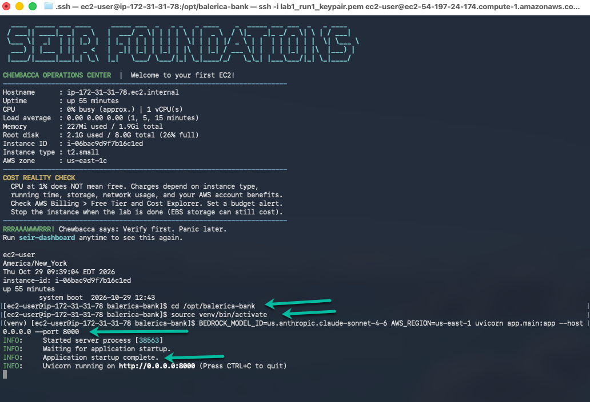

---

## Step 5 — Open a second terminal (Window 2)

Open a **new** terminal tab/window on your computer and SSH into the **same** EC2 instance.

💻 **Run on: Local machine — macOS (Terminal, new tab)**

```bash
ssh -i your-key.pem ec2-user@YOUR-EC2-IP
```

💻 **Run on: Local machine — Windows (PowerShell, new window)**

```powershell
ssh -i .\your-key.pem ec2-user@YOUR-EC2-IP
```

You now have:

```
Window 1: the bank is running (leave it alone)
Window 2: you, the customer (type here from now on)
```

☁️ **Run on: Linux EC2 instance** (Window 2)

Check the API is answering:

```bash
curl http://127.0.0.1:8000/status
```

Expected:

```
{"platform":"Balerica Legacy Bank","environment":"Amazon EC2","api":"online","core_banking":"GnuCOBOL"}
```

Run the "enterprise diagnostic":

```bash
curl http://127.0.0.1:8000/chewbacca
```

> A Wookiee response means the platform is healthy.

📸 **Screenshot — both windows side by side, `/status` response in Window 2**

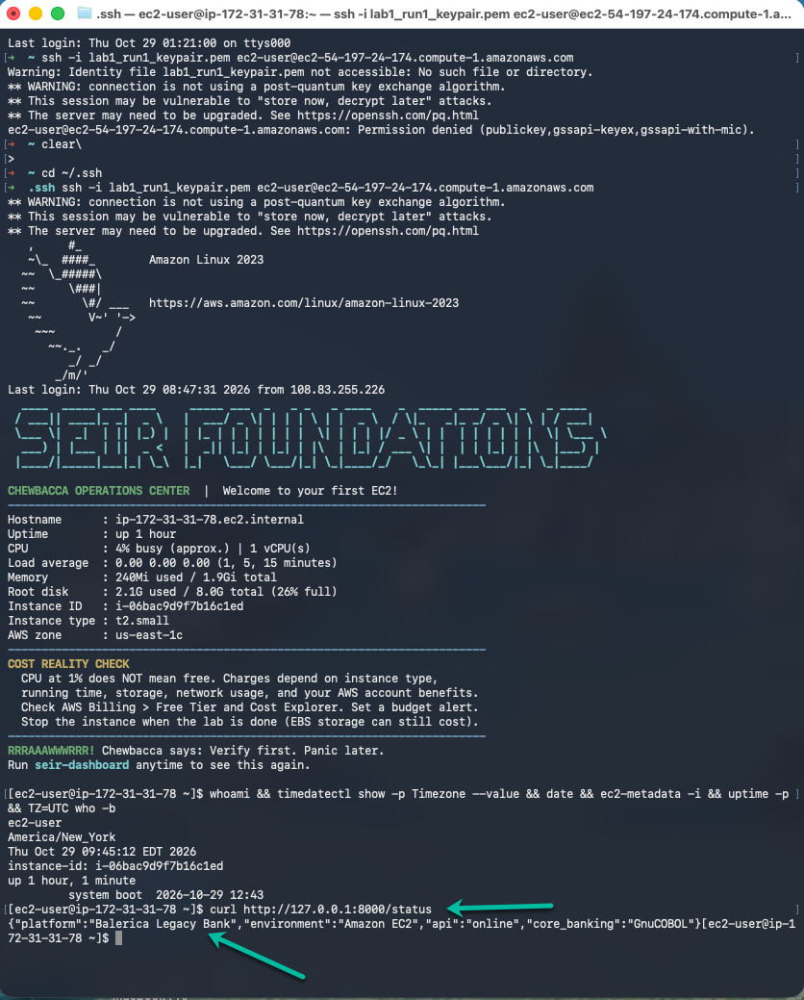

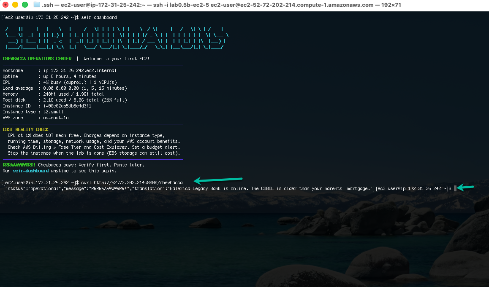

---

## Step 6 — Send SWIFT traffic

☁️ **Run on: Linux EC2 instance** (Window 2)

```bash
cd /opt/balerica-bank
```

```bash
python3 swift/traffic_generator.py --count 10
```

Expected (numbers will differ):

```
[1/3] Connectivity check: http://127.0.0.1:8000/status
  OK (200) in 16 ms - core: GnuCOBOL

[2/3] Sending 10 MT103 payment(s)...
  SWIFT-0001  100001      332.63 USD  -> POSTED   APPROVED  (7 ms)
  SWIFT-0002  999999      243.30 USD  -> REJECTED ACCOUNT NOT FOUND  (7 ms)
  ...

[3/3] Traffic report
  Sent     : 10
  POSTED   : 7
  REJECTED : 3  (expected - the core must reject bad payments)
  FAILED   : 0  (connectivity or server errors)

  CONNECTIVITY CONFIRMED.
  Modern edge and COBOL core are talking.
```

> ✅ **REJECTED is not a failure** — about a third of the traffic is intentionally bad. The only number that must be **0** is `FAILED`.

📸 **Screenshot — traffic report showing `FAILED : 0` and "CONNECTIVITY CONFIRMED"**

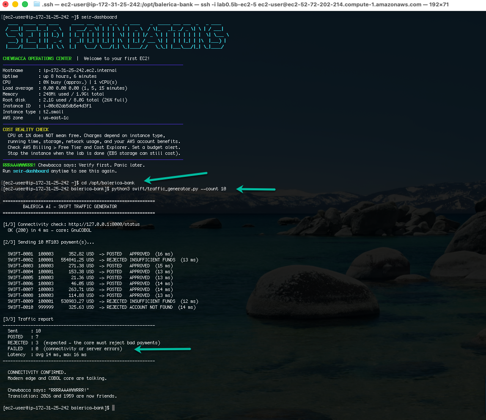

Optional — view raw MT103 messages:

```bash
python3 swift/traffic_generator.py --count 3 --show-mt103
```

> Look at Window 1: each payment you sent appears in the server log.

📸 **Screenshot — Optional — view raw MT103 messages:**

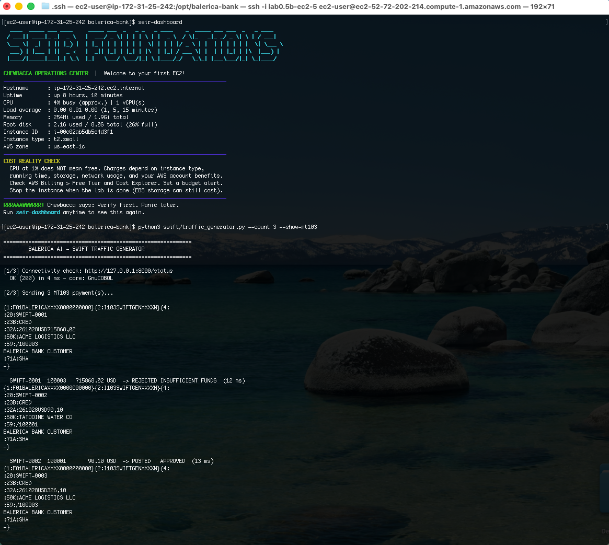

📸 **Screenshot — Window 1 server log showing the incoming requests**

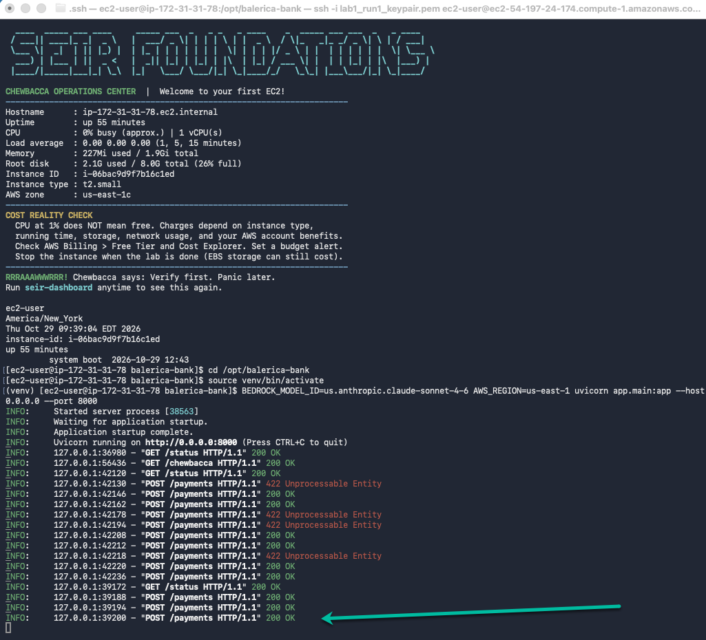

---

## Step 7 — Explore the API from your browser

🌐 **Run on: Local machine — Web browser** (macOS or Windows)

Open (replace with your instance's public IP):

```
http://YOUR-EC2-IP:8000/docs
```

1. Click **`GET /accounts/{account_id}`**
2. Click **Try it out**
3. Enter `100001`
4. Click **Execute** — the COBOL program answers your browser.

**If the page never loads**, port 8000 is blocked by the Security Group.

🌐 **Run on: Local machine — Web browser → AWS Console**

EC2 → your instance → **Security** tab → Security group → **Edit inbound rules** → **Add rule**:

| Type | Port | Source |
|------|------|--------|
| Custom TCP | `8000` | My IP |

Click **Save rules**, then reload the `/docs` page.

📸 **Screenshot — Security Group inbound rule for port 8000** *(if you needed it)*

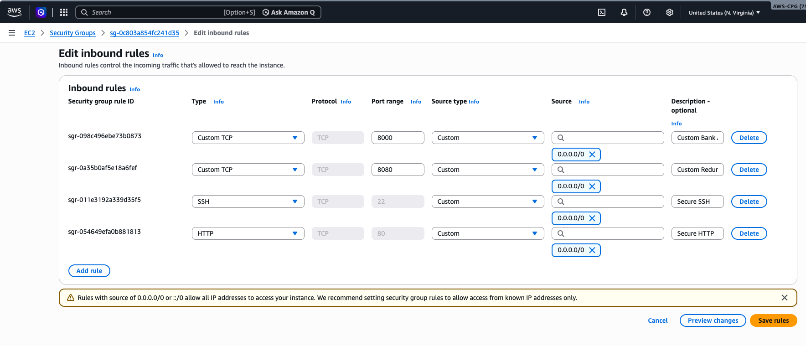

📸 **Screenshot — `/docs` page with the account 100001 response**

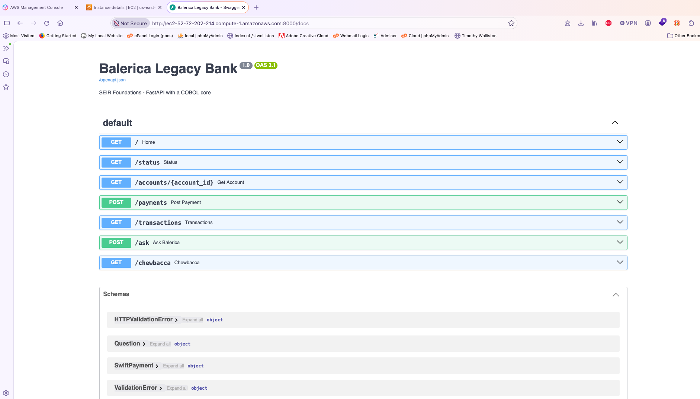

---

## Step 8 — Ask Balerica AI for help

☁️ **Run on: Linux EC2 instance** (Window 2)

## Original version
```bash
curl -X POST http://127.0.0.1:8000/ask \
  -H 'Content-Type: application/json' \
  -d '{"question": "What does return code 8 mean?"}'
```
** -or- **

## Invoke AWS Bedrock version
```bash
curl -X POST http://127.0.0.1:8000/ask \
  -H 'Content-Type: application/json'   \
  -d '{"question": "What does return code 8 mean?", 
  "model_id": "us.anthropic.claude-sonnet-4-6", 
  "region": "us-east-1"}'
```

The answer is grounded in your live ledger and recent transactions.

- **With** an IAM role that has Amazon Bedrock access → the answer comes from a foundation model.
- **Without** it → the response includes `"source": "offline-knowledge-base"`.

> ✅ **Both are correct.** Offline mode lets the lab work before the AWS AI part is set up.

### Student Challenge (optional)

1. 🌐 **AWS Console (browser):** in Amazon Bedrock → **Model access**, enable a Claude model.
2. ☁️ **EC2 (Window 1):** stop the server with `Ctrl+C`, set `BEDROCK_MODEL_ID` (and `AWS_REGION` if needed), then restart uvicorn. Newer Claude models need the **inference profile** ID (starts with `us.`), not the base model ID.

### Why `/ask` might silently stay offline

All three must be true before Bedrock answers — any one wrong looks identical (`offline-knowledge-base`):

1. **An IAM role is attached to the instance** with Bedrock permissions — see `iam/PERMISSIONS.md` in the lesson folder (instructor action; needs IAM admin rights).
2. **`AWS_REGION` matches the region where you enabled model access** — the code defaults to `us-east-1` if unset.
3. **`BEDROCK_MODEL_ID` is a real model / inference-profile ID**, not the shipped placeholder.

📸 **Screenshot — `/ask` response (offline or Bedrock)**

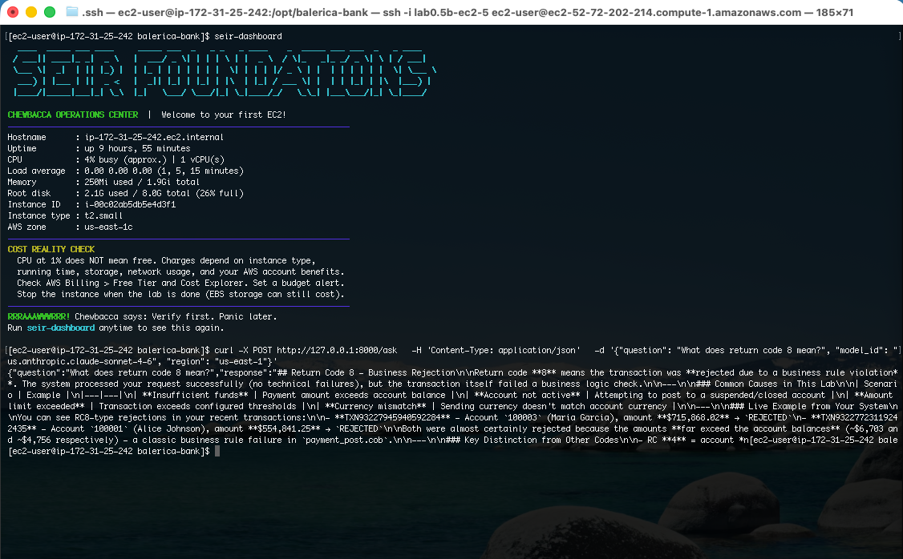

---

## Step 9 — Closing time

☁️ **Run on: Linux EC2 instance** (Window 1)

Press **`Ctrl+C`** to stop the server.

Your data is kept in `data/bank.db` and the journal files. Next time, repeat **Step 4** to reopen the bank where you left off.

> 💡 To avoid AWS charges, **stop** the EC2 instance from the AWS Console when you're done for the day (don't terminate it if you want to keep your work).

📸 **Screenshot — server stopped (prompt returned in Window 1)**

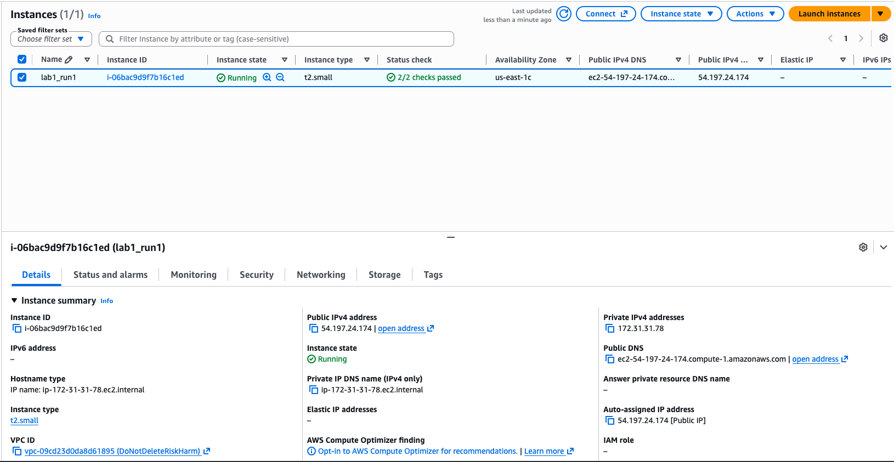

---

## Reference

### Architecture

```
SWIFT Traffic Generator        (swift/traffic_generator.py)
         |
         v  HTTP / JSON
      FastAPI                  (app/main.py)
         |
         v  subprocess
   cobol_bridge.py             (app/cobol_bridge.py)
         |
         v  argv + KEY=VALUE stdout
account_lookup / payment_post  (cobol/*.cob, compiled by GnuCOBOL)
         |
         v  fixed-width records
accounts.dat / payments.dat    (data/)
         |
         v  export / ingest
       SQLite                  (data/bank.db — system of record)

Helper:
      POST /ask  ->  Balerica AI helper  ->  Amazon Bedrock
                     (agents/balerica.py)    (offline fallback built in)
```

### API endpoints

| Endpoint | What it does |
|----------|--------------|
| `GET /status` | platform heartbeat |
| `GET /accounts/{id}` | runs `account_lookup` (COBOL answers) |
| `POST /payments` | runs `payment_post` (COBOL renders verdict) |
| `GET /transactions` | the SQLite journal |
| `POST /ask` | Balerica AI helper agent |
| `GET /chewbacca` | essential enterprise diagnostics |

### Fixed-width ledger (`data/accounts.dat`)

```
Columns  1-6   account id       PIC X(6)
Columns  7-36  customer name    PIC X(30)
Columns 37-44  status           PIC X(8)
Columns 45-56  balance          PIC 9(10)V99   (implied decimal)
Columns 57-59  currency         PIC X(3)
```
---

## Lab Run Log (graded table)

> Fill in each row right after the run. Instance ID and Boot time must match the screenshot **character for character**.

| Run | Date | Time zone | Instance ID | Boot time (UTC) | Public IPv4 DNS | Screenshot | Terminated? |
|-----|------|-----------|-------------|-----------------|-----------------|------------|-------------|
| 1 | 2026-10-29 | America/New_York | i-06bac9d9f7b16c1ed | 2026-10-29 12:43:00 | ec2-54-197-24-174.compute-1.amazonaws.com | [lab1_run1.jpg](screenshots/lab1_run1.jpg) | Yes |
| 2 |2026-10-29 | | i-03654eddcd51d549f | 2026-10-29 15:15:00| | [lab1_run2.jpg](screenshots/lab1_run2.jpg) | |
| 3 | 2026-10-29| America/New_York |i-0d8a2c7ba9fd28649 |2026-10-29 16:45:00 |ec2-54-163-49-37.compute-1.amazonaws.com | [lab1_run3.jpg](screenshots/lab1_run3.jpg) | |
| 4 | | | | | | [lab1_run4.jpg](screenshots/lab1_run4.jpg) | |
| 5 | | | | | | [lab1_run5.jpg](screenshots/lab1_run5.jpg) | |
| 6 | | | | | | [lab1_run6.jpg](screenshots/lab1_run6.jpg) | |
| 7 | | | | | | [lab1_run7.jpg](screenshots/lab1_run7.jpg) | |

**Self-audit before submitting:**
- 7 different Instance IDs? 7 different DNS names?
- No date has more than 3 runs? At least 3 distinct dates?
- Every boot time is **before** its screenshot and **within 24 h** of it?

---

### Troubleshooting

| Symptom | Where | What to do |
|---------|-------|-----------|
| `Permission denied (publickey)` on SSH | Local machine | Wrong key or user — use `ec2-user@` and your `.pem` (on macOS run `chmod 400 your-key.pem`) |
| `git: command not found` | EC2 | Run `sudo dnf install -y git` (Step 1) |
| Installer stops with an error | EC2 | Re-run it — it's safe to re-run |
| `cobc: command not found` | EC2 | Re-run the installer (Step 2 installs GnuCOBOL) |
| `FILE-STATUS=35` / return code 12 | EC2 | Wrong folder — `cd /opt/balerica-bank` first |
| `(venv)` missing from prompt | EC2 | `source venv/bin/activate` again (it's per terminal) |
| `command not found: uvicorn` | EC2 | Activate the venv first |
| Traffic generator prints `UNREACHABLE` | EC2 | Server isn't running in Window 1 — redo Step 4 |
| `/docs` never loads | Browser / AWS Console | Open port 8000 in the Security Group (Step 7) |
| Every payment REJECTED | EC2 | Read the `REASON=` line — the core always explains |
| `/ask` says `offline-knowledge-base` | EC2 / AWS Console | Expected early on; after the challenge, check IAM role, `AWS_REGION`, `BEDROCK_MODEL_ID` |

---

## ✅ Completion checklist

| # | Step | Where | Done |
|---|------|-------|------|
| P | SSH'd into the EC2 instance (Window 1) | macOS / Windows | ☐ |
| 0 | Confirmed I'm `ec2-user` in `/home/ec2-user` | EC2 | ☐ |
| 1 | Installed git and cloned `SEIR-Foundations` | EC2 | ☐ |
| 2 | Ran the installer and saw `Installation complete.` | EC2 | ☐ |
| 3 | Ran COBOL account lookups, checked return codes, posted a payment and viewed the journal | EC2 | ☐ |
| 4 | Activated the venv and started the API with uvicorn | EC2 | ☐ |
| 5 | Opened Window 2 and got responses from `/status` and `/chewbacca` | macOS / Windows → EC2 | ☐ |
| 6 | Sent SWIFT traffic with `FAILED : 0` and "CONNECTIVITY CONFIRMED" | EC2 | ☐ |
| 7 | Opened `/docs` in the browser and looked up account 100001 (opened port 8000 if needed) | Browser / AWS Console | ☐ |
| 8 | Asked Balerica AI a question via `/ask` | EC2 | ☐ |
| 9 | Stopped the server with `Ctrl+C` (and stopped the instance if done) | EC2 / AWS Console | ☐ |
| 📸 | Added screenshots for each step to `screenshots/` | — | ☐ |

> Prefer GitHub-clickable checkboxes? Use this version instead:

- [ ] **Prerequisites** — SSH into EC2 (Window 1) · *macOS / Windows*
- [ ] **Step 0** — Confirmed user and location · *EC2*
- [ ] **Step 1** — Installed git and cloned the course repo · *EC2*
- [ ] **Step 2** — Installer finished with `Installation complete.` · *EC2*
- [ ] **Step 3** — COBOL lookup, return codes, payment posted · *EC2*
- [ ] **Step 4** — API running with uvicorn · *EC2*
- [ ] **Step 5** — Second terminal connected, `/status` answered · *macOS / Windows → EC2*
- [ ] **Step 6** — SWIFT traffic sent, `FAILED : 0` · *EC2*
- [ ] **Step 7** — `/docs` works in browser · *Browser / AWS Console*
- [ ] **Step 8** — `/ask` answered · *EC2*
- [ ] **Step 9** — Server stopped · *EC2*
- [ ] **Screenshots** added for every step
